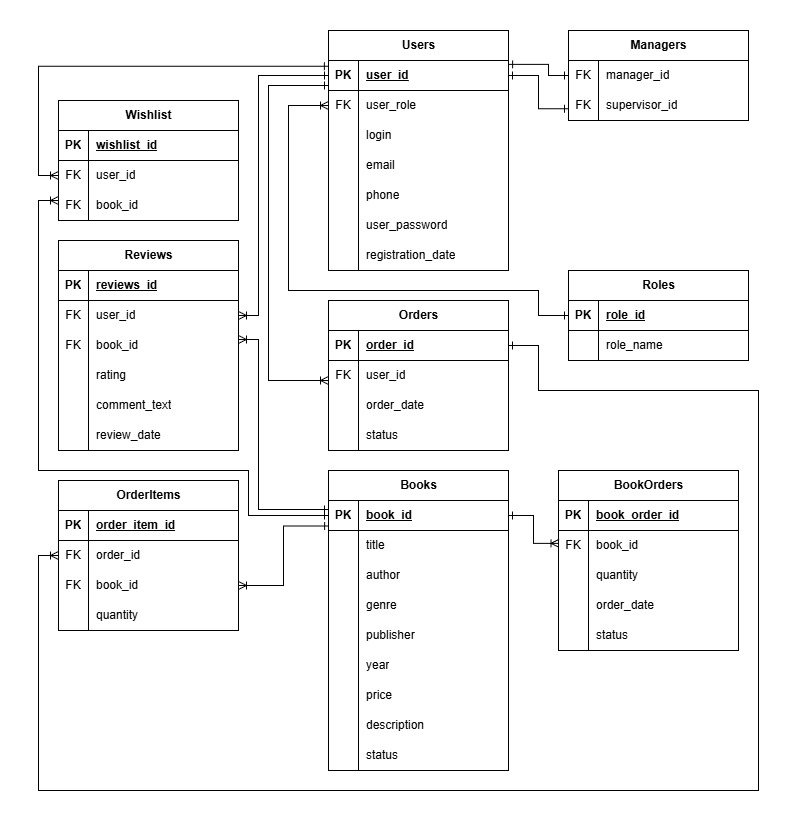
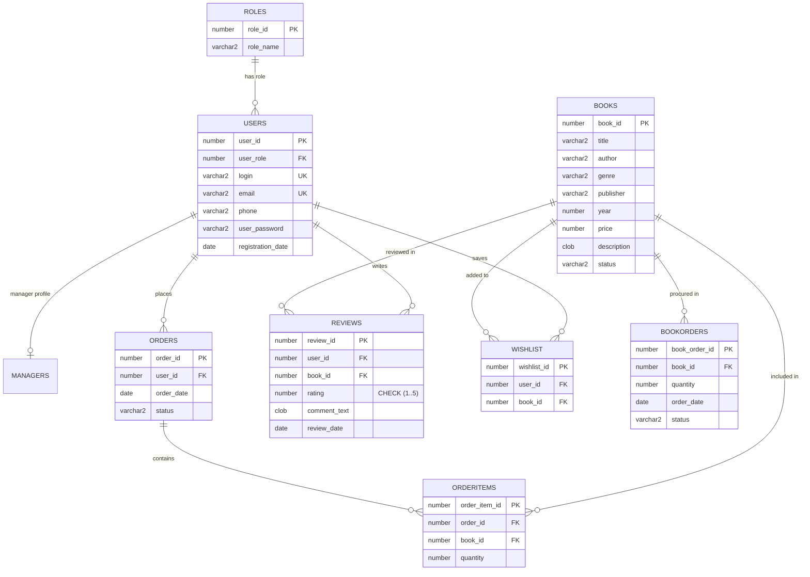
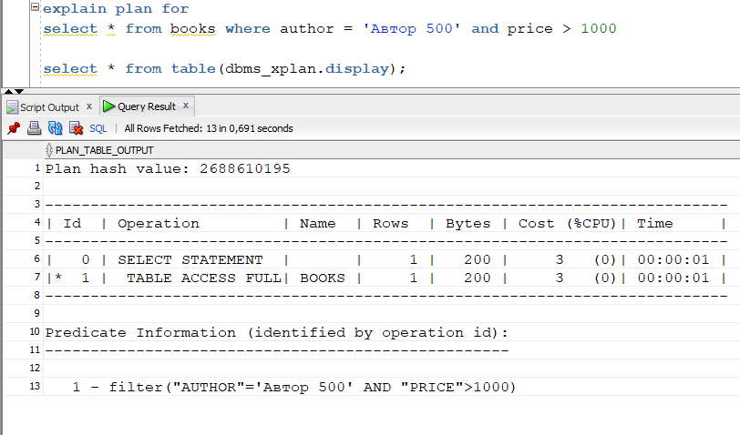
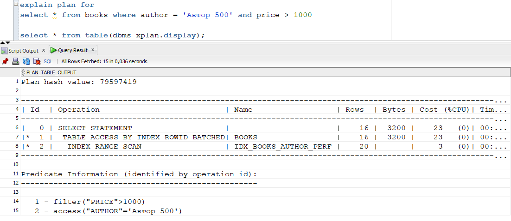

# 📚 Oracle Database — Bookstore Management System

[](https://www.oracle.com/database/)
[](https://www.oracle.com/database/technologies/appdev/plsql.html)
[](docs/diagrams/er_schema.jpg)
[](docs/reports/rman_backup_guide.txt)
[](docs/performance/)

Комплексный проект реляционной базы данных для книжного интернет-магазина, разработанный в СУБД **Oracle Database**. Охватывает полный жизненный цикл проектирования и администрирования БД: концептуальное и логическое моделирование, ролевая безопасность (RBAC), бизнес-логика на стороне сервера (PL/SQL процедуры, функции, триггеры), оптимизация производительности (индексы и анализ планов выполнения `EXPLAIN PLAN`), а также стратегия резервного копирования и восстановления с помощью **Oracle RMAN**.

---

## 📑 Содержание

- [Архитектура и логическая схема (ERD)](#-архитектура-и-логическая-схема-erd)
- [Структура таблиц и целостность данных](#-структура-таблиц-и-целостность-данных)
- [Ролевая модель доступа (RBAC)](#-ролевая-модель-доступа-rbac)
- [Серверная бизнес-логика (PL/SQL)](#-серверная-бизнес-логика-plsql)
- [Оптимизация производительности и Индексы](#-оптимизация-производительности-и-индексы)
- [Резервное копирование и восстановление (RMAN)](#-резервное-копирование-и-восстановление-rman)
- [Экспорт и импорт данных (Oracle Data Pump)](#-экспорт-и-импорт-данных-oracle-data-pump)
- [Структура репозитория](#-структура-репозитория)
- [Инструкция по развертыванию](#-инструкция-по-развертыванию)

---

## 🏛 Архитектура и логическая схема (ERD)

Система построена на третьей нормальной форме (3NF), обеспечивая устранение избыточности и целостность данных через первичные и внешние ключи (`Primary Key`, `Foreign Key`), ограничения `CHECK` и `UNIQUE`.

### Логическая схема базы данных



### Сущности и связи (Mermaid ERD)



---

## 🗃 Структура таблиц и целостность данных

| Таблица | Назначение | Ключевые ограничения |
| :--- | :--- | :--- |
| **`ROLES`** | Справочник ролей пользователей в системе | `PRIMARY KEY (role_id)` |
| **`USERS`** | Пользователи (покупатели, менеджеры, старшие менеджеры) | `UNIQUE (login)`, `UNIQUE (email)`, `FK (user_role)` |
| **`MANAGERS`** | Иерархия персонала (менеджеры и руководители) | `FK (manager_id)`, `FK (supervisor_id) -> Self-referencing` |
| **`BOOKS`** | Каталог книг, авторов, цен и статусов наличия | `PRIMARY KEY (book_id)`, `DEFAULT status 'Нет в наличии'` |
| **`ORDERS`** | Заказы покупателей со статусами жизненного цикла | `FK (user_id)`, `DEFAULT status 'Принят'` |
| **`ORDERITEMS`** | Позиции внутри конкретного заказа | `FK (order_id)`, `FK (book_id)`, `quantity DEFAULT 1` |
| **`BOOKORDERS`** | Заказы книг у поставщиков для пополнения склада | `FK (book_id)`, `quantity > 0` |
| **`WISHLIST`** | Список желаемых книг («Избранное») | `FK (user_id)`, `FK (book_id)` |
| **`REVIEWS`** | Отзывы и оценки покупателей на книги | `CHECK (rating BETWEEN 1 AND 5)`, `FK (user_id)`, `FK (book_id)` |

---

## 🔐 Ролевая модель доступа (RBAC)

Безопасность строится на принципе наименьших привилегий через отдельные роли Oracle Database:

```
                  ┌────────────────────────┐
                  │    DBA / PROGRAMMER    │
                  │   (Полный DDL и DML)   │
                  └───────────┬────────────┘
                              │
         ┌────────────────────┼────────────────────┐
         ▼                    ▼                    ▼
┌──────────────────┐ ┌──────────────────┐ ┌──────────────────┐
│  SENIOR MANAGER  │ │  SALES MANAGER   │ │     CUSTOMER     │
│                  │ │                  │ │                  │
│ • Аналитика      │ │ • Каталог книг   │ │ • Просмотр книг  │
│ • Заказ поставщику│ │ • Обработка заказ│ │ • Оформление заказ│
│ • Назначение рук.│ │ • Мониторинг склад│ │ • Отзывы/рейтинги│
└──────────────────┘ └──────────────────┘ └──────────────────┘
```

1. **`Customer` (Покупатель):**
   - Доступ к просмотру каталога книг.
   - Управление своей корзиной и оформление заказов.
   - Ведение списка избранного (`Wishlist`).
   - Написание рецензий и выставление оценок от 1 до 5 звезд.

2. **`Sales_manager` (Менеджер по продажам):**
   - Добавление новых поступлений в каталог с проверкой на дубликаты.
   - Изменение статуса заказов клиентов (`Принят`, `В обработке`, `Доставлен`).
   - Мониторинг остатков на складе.

3. **`Senior_manager` (Старший менеджер):**
   - Управление цепочками поставок — закупка книг у оптовых поставщиков (`orderbooksfromsupplier_by_title_proc`).
   - Контроль распределения менеджеров по супервайзерам.
   - Аналитические сводки и финансовые отчеты.

---

## ⚙ Серверная бизнес-логика (PL/SQL)

Вся ключевая бизнес-логика инкапсулирована в хранимые процедуры, функции и триггеры для гарантии целостности транзакций и производительности:

- **Автоматическая регистрация (`registration_proc`):** Валидация существования роли, проверка уникальности логина/email, хеширование и создание учетной записи.
- **Работа с каталогом (`add_book`):** Проверка на наличие книги-дубликата по композитному ключу `(UPPER(title), UPPER(author), UPPER(publisher), year)` перед вставкой.
- **Заказ у поставщиков (`orderbooksfromsupplier_by_title_proc`):** Проверка наличия книги в справочнике, валидация положительного объема поставки, автоматическое обновление статуса заказа.
- **Управление избранным (`add_to_wishlist`, `remove_from_wishlist`):** Проверка на повторное добавление, атомарное удаление, перехват исключений с `ROLLBACK`.
- **Контроль транзакций:** Обработка ошибок в блоках `EXCEPTION WHEN OTHERS THEN ROLLBACK` с логированием сообщений через `DBMS_OUTPUT`.

---

## 🚀 Оптимизация производительности и Индексы

Для высоконагруженных выборок разработана комплексная стратегия индексирования:

### 1. Функциональные индексы (Function-Based Indexes)
Для поддержки регистронезависимого поиска без сканирования всей таблицы (`TABLE ACCESS FULL`):
```sql
CREATE INDEX idx_users_login_upper ON users(UPPER(login));
CREATE INDEX idx_books_title_upper ON books(UPPER(title));
CREATE INDEX idx_books_author_upper ON books(UPPER(author));
CREATE INDEX idx_books_publisher_upper ON books(UPPER(publisher));
```

### 2. Составные и фильтрующие индексы
```sql
-- Ускорение поиска активной корзины пользователя
CREATE INDEX idx_orders_user_status ON orders(user_id, status);

-- Ускорение соединений JOIN и списания остатков
CREATE INDEX idx_orderitems_order_id ON orderitems(order_id);
CREATE INDEX idx_orderitems_book_id  ON orderitems(book_id);

-- Индекс для FIFO-очереди заказов поставщикам
CREATE INDEX idx_bookorders_fifo     ON bookorders(book_id, book_order_id);

-- Устранение дубликатов в избранном
CREATE INDEX idx_wishlist_user_book  ON wishlist(user_id, book_id);
```

### 3. Анализ плана выполнения (`EXPLAIN PLAN`)

Было проведено нагрузочное тестирование планов выполнения запросов с помощью пакета `DBMS_XPLAN`.

| До оптимизации (Full Table Scan) | После добавления индексов (Index Range Scan) |
| :---: | :---: |
|  |  |

**Результаты оптимизации:**
- Стоимость запроса (`Cost / CPU Cost`) снижена в разы.
- `TABLE ACCESS FULL` заменен на `INDEX RANGE SCAN` и `TABLE ACCESS BY INDEX ROWID BATCHED`.
- Время отклика поиска по названию книги и логину пользователя сокращено до долей миллисекунды.
- Сбор статистики оптимизатора выполнен через `DBMS_STATS.GATHER_SCHEMA_STATS`.

---

## 💾 Резервное копирование и восстановление (RMAN)

Для обеспечения непрерывности бизнеса и защиты от сбоев настроена промышленная система бекапирования на базе **Oracle Recovery Manager (RMAN)**:

```bash
# Перевод базы данных в режим ArchiveLog
ALTER SESSION SET CONTAINER = CDB$ROOT;
SHUTDOWN IMMEDIATE;
STARTUP MOUNT;
ALTER DATABASE ARCHIVELOG;
ALTER DATABASE OPEN;
```

**Политика резервного копирования:**
1. **Окно восстановления:** `CONFIGURE RETENTION POLICY TO RECOVERY WINDOW OF 7 DAYS;`
2. **Автоматический бэкап контрольного файла:** `CONFIGURE CONTROLFILE AUTOBACKUP ON;`
3. **Аппаратное сжатие бекапов:** `CONFIGURE DEVICE TYPE DISK BACKUP TYPE TO COMPRESSED BACKUPSET;`
4. **Оптимизация дублей:** `CONFIGURE BACKUP OPTIMIZATION ON;`
5. **Область быстрого восстановления (Fast Recovery Area):** лимит 10 Гб в каталоге `/home/oracle/rman_backups`.

Скрипт создания инкрементального/полного бэкапа со сбросом архивных логов:
```sql
BACKUP DATABASE PLUS ARCHIVELOG DELETE INPUT;
```

---

## 📦 Экспорт и импорт данных (Oracle Data Pump)

Для миграции схемы и тестовых данных реализована поддержка утилит **Oracle Data Pump** (`expdp` / `impdp`):
- Экспорт метаданных и схемы пользователя через директорию Oracle `DATA_PUMP_DIR`.
- Быстрое восстановление тестового окружения разработчика.

---

## 📂 Структура репозитория

```
bookstore-database-oracle/
├── README.md                      # Документация проекта (вы здесь)
├── .gitignore                     # Исключение временных и бинарных файлов
├── docs/
│   ├── diagrams/                  # Архитектурные схемы и модели
│   │   ├── er_schema.jpg          # Полная логическая схема БД
│   │   ├── role_customer.jpg      # Процессы покупателя
│   │   ├── role_sales_manager.jpg # Процессы менеджера по продажам
│   │   ├── role_senior_manager.jpg# Процессы старшего менеджера
│   │   └── *.drawio.xml           # Исходники схем в draw.io
│   ├── performance/               # Скриншоты метрик и планов выполнения
│   │   ├── explain_plan_before_index.png
│   │   ├── explain_plan_after_index.png
│   │   └── ...
│   └── reports/                   # Пояснительная записка и инструкции
│       ├── coursework_full_report.docx
│       └── rman_backup_guide.txt
└── sql/                           # Набор SQL и PL/SQL скриптов
    ├── 00_sys_init.sql            # Создание PDB, табличных пространств, юзера programmer
    ├── 01_tables.sql              # DDL: создание таблиц и ограничений (PK, FK, CHECK)
    ├── 02_user_roles.sql          # Создание ролей БД и процедура регистрации
    ├── 03_grants_and_synonyms.sql # Назначение прав и синонимов
    ├── 04_seed_data.sql           # Тестовые данные для каталога и пользователей
    ├── 05_customer_api.sql        # PL/SQL пакет процедур для Покупателя
    ├── 06_sales_manager_api.sql   # PL/SQL пакет процедур для Менеджера
    ├── 07_senior_manager_api.sql  # PL/SQL пакет процедур для Старшего менеджера
    ├── 08_indexes.sql             # Создание индексов (B-Tree, Function-Based)
    ├── 09_explain_plans.sql       # Запросы проверки планов выполнения (DBMS_XPLAN)
    ├── 10_performance_test.sql    # Скрипты нагрузочного тестирования
    ├── 11_export_import.sql       # Настройки Oracle Data Pump
    ├── 12_rman_backup.sql         # Конфигурация RMAN
    ├── 13_tests_and_verification.sql # Тесты сквозных сценариев
    └── 14_data_cleanup_utils.sql  # Утилиты очистки тестовых данных
```

---

## 🛠 Инструкция по развертыванию

### Требования
- СУБД **Oracle Database** (19c, 21c, или 23c Free / XE).
- Инструмент подключения: **SQL Developer**, **DBeaver** или консольный **SQL*Plus**.

### Порядок запуска скриптов:

1. **Инициализация табличных пространств и пользователя (под SYSDBA):**
   ```sql
   @sql/00_sys_init.sql
   ```
2. **Создание структуры таблиц и целостности:**
   ```sql
   @sql/01_tables.sql
   ```
3. **Настройка ролевой модели и прав:**
   ```sql
   @sql/02_user_roles.sql
   @sql/03_grants_and_synonyms.sql
   ```
4. **Заполнение первичными данными (каталог, категории):**
   ```sql
   @sql/04_seed_data.sql
   ```
5. **Компиляция процедур и бизнес-логики:**
   ```sql
   @sql/05_customer_api.sql
   @sql/06_sales_manager_api.sql
   @sql/07_senior_manager_api.sql
   ```
6. **Создание индексов и сбор статистики CBO:**
   ```sql
   @sql/08_indexes.sql
   ```
7. **Прогон тестов и планов выполнения:**
   ```sql
   @sql/09_explain_plans.sql
   @sql/13_tests_and_verification.sql
   ```

---

## 👩‍💻 Автор

**Юлия (Yuliya)**  
- Студентка БГТУ (Факультет ИТ, Информационные системы и технологии)  
- GitHub: [@yk-jivi](https://github.com/yk-jivi)
